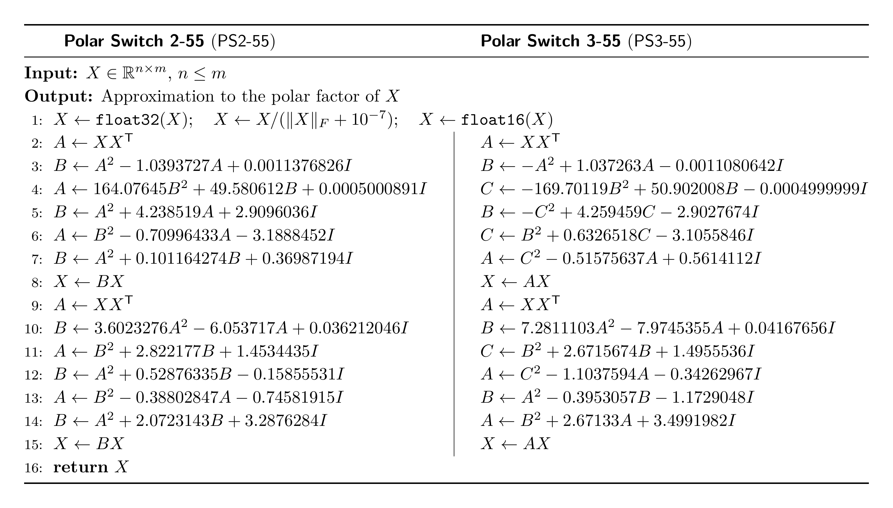
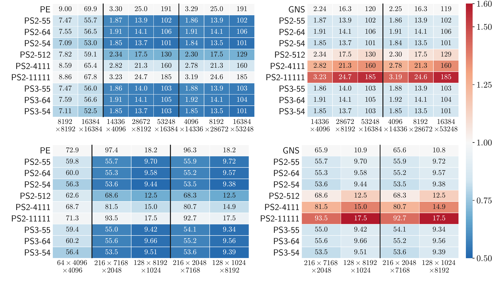
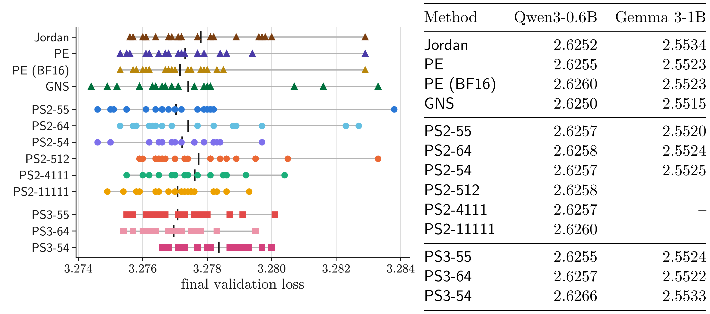

<h1 align="center">Polar Switch</h1>

**Polar Switch uses high-degree polynomial circuits to make matrix orthogonalization in [Muon](https://github.com/KellerJordan/Muon) faster.**

[Zhehang Du](https://zhehangdu.github.io/) and [Weijie Su](https://www.weijie-su.com/) (2026).<br>
[*Polar Switch: Fast Muon Orthogonalization with Polynomial Circuits*](https://arxiv.org/abs/2610.26742).<br>
arXiv:2610.26742.

<p align="center">
  🚀 <a href="#getting-started">Getting started</a> &nbsp;·&nbsp;
  📊 <a href="#results">Accuracy and timing</a> &nbsp;·&nbsp;
  🧪 <a href="#training-results">LLM pretraining</a> &nbsp;·&nbsp;
  📖 <a href="#citation">Citation</a>
</p>

[](figures/polar_switch_algorithms.png)

<a id="getting-started"></a>

## 🚀 Getting started

The package requires Linux, Python 3.12 or newer, and PyTorch 2.14.0. It was tested only on NVIDIA B200; other GPUs may need changes.

[Matrix orthogonalization guide →](polar_switch/README.md)

### Custom GPU kernels

For Hopper and Blackwell GPUs, such as H100, H200, B200, and B300 (compute capability 9.0–12.x), install PyTorch 2.14.0 and the package with QuACK 0.6.5 and CUTLASS DSL 4.8.0:

```bash
git clone https://github.com/zhehangdu/polar-switch.git && cd polar-switch
python -m pip install torch==2.14.0 --index-url https://download.pytorch.org/whl/cu130  # NVIDIA driver 580 or newer
python -m pip install -e ".[kernels]"
```

With an older driver, install a CUDA 12 build of PyTorch 2.14.0 from the [official instructions](https://pytorch.org/get-started/locally/) instead.

```python
import torch
from polar_switch import make_polynomial_orthogonalizer

orthogonalize = make_polynomial_orthogonalizer("PS2_55")
with torch.no_grad(), torch.autocast("cuda", enabled=False):
    update = orthogonalize(torch.randn(1024, 2048, device="cuda"))
```

Create the orthogonalizer once and reuse it; it also accepts batches with shape `(..., rows, columns)`.

### PyTorch and Triton

For other GPUs, install PyTorch 2.14.0 for your platform from the [official instructions](https://pytorch.org/get-started/locally/) and run `python -m pip install -e .`. The example above then runs the same circuit with Triton kernels.

- **Fallback order:** QuACK, then Triton, then `POLAR_EXPRESS` in PyTorch. If one cannot run, you get a warning and the next one runs. QuACK needs both matrix dimensions to be at least 256 and multiples of 8.
- **Rounding:** We designed the circuits for FP16 operands, FP32 accumulation, and one FP16 rounding per inner iteration. QuACK and Triton do each inner iteration in one kernel, so they round only once. Separate PyTorch operations round more often, so the PyTorch fallback runs Polar Express instead of the circuit. If you write your own implementation, use one kernel per inner iteration with FP32 accumulation and one rounding.
- **Triton tuning:** The Triton kernels use fixed settings from Modded-NanoGPT, tuned for H100. **Other matrix sizes and GPUs may need new tuning.**

<a id="results"></a>

## 📊 Accuracy and timing

### Singular value interval

Memory in matrix elements, FLOPs, and final interval for singular values in $[0.001, 1]$, for $X\in\mathbb{R}^{n\times m}$ with $n\le m$ and $\alpha=m/n$. `Jordan`, `PE`, and `GNS` have final intervals centered at one.

<div align="center">

| Method | Memory | FLOPs | Final interval |
| :---: | :---: | :---: | :---: |
| [Jordan](https://github.com/KellerJordan/Muon) | $n^2(2\alpha+2)$ | $(15\alpha+5)n^3$ | $[0.562544, 1.437456]$ |
| [Polar Express](https://proceedings.iclr.cc/paper_files/paper/2026/file/df88b275bef31ac96c85f0c4013734fc-Paper-Conference.pdf) (`PE`) | $n^2(2\alpha+2)$ | $(15\alpha+5)n^3$ | $[0.858872, 1.141128]$ |
| [Gram Newton–Schulz](https://dao-ailab.github.io/blog/2026/gram-newton-schulz/) (`GNS`) | $n^2(2\alpha+4)$ | $(6\alpha+14)n^3$ | $[0.787021, 1.212979]$ |
| **Polar Switch 2-55** (`PS2-55`) | $n^2(2\alpha+2)$ | $(6\alpha+10)n^3$ | $[0.872263, 1.106236]$ |
| **Polar Switch 3-55** (`PS3-55`) | $n^2(2\alpha+3)$ | $(6\alpha+10)n^3$ | $[0.898309, 1.080954]$ |

</div>

### Orthogonalization time

Median latency (ms) on one NVIDIA B200 GPU for single matrices (top) and batches (bottom), with ratios to Polar Express (left) and to Gram Newton–Schulz on rectangular matrices (right).

[](figures/fp16_timing_heatmaps.png)

<a id="training-results"></a>

## 🧪 LLM pretraining

To reproduce these runs, see the [training guide](training/README.md). The [training records](training/results/README.md) contain losses and training times, with approximate MFU reported only for Qwen3 and Gemma 3.

> [!IMPORTANT]
> The training scripts are optimized for one NVIDIA B200 GPU with PyTorch 2.14.0 and CUDA 13.0. They may not work on other GPUs or software versions without adapting the code.

Final validation loss of Modded-NanoGPT #91 and of Qwen3-0.6B and Gemma 3-1B. `PE (BF16)` is Polar Express in `bfloat16`.

[](figures/training_results.png)

<a id="citation"></a>

## 📖 Citation

```bibtex
@article{du2026polar,
  author = {Zhehang Du and Weijie Su},
  title = {{Polar Switch}: Fast {Muon} Orthogonalization with Polynomial Circuits},
  journal = {arXiv preprint arXiv:2610.26742},
  year = {2026},
}
```

## 🤝 Acknowledgments and licenses

Polar Switch builds on [Muon](https://github.com/KellerJordan/Muon), [Polar Express](https://proceedings.iclr.cc/paper_files/paper/2026/file/df88b275bef31ac96c85f0c4013734fc-Paper-Conference.pdf), [Gram Newton–Schulz](https://dao-ailab.github.io/blog/2026/gram-newton-schulz/), [QuACK](https://github.com/Dao-AILab/quack/tree/10ce505a7ecf68e46753009bd08dcf9bd6c059ee), and [CUTLASS DSL](https://github.com/NVIDIA/cutlass/tree/098de2a652cf8f00fd70b2df54051c7eccbb855a). NanoGPT training is based on [Modded-NanoGPT](https://github.com/KellerJordan/modded-nanogpt/tree/bc3a0c2d640d0d73dedaef87eae26148d2e32afb) record #91 with [FlashAttention-4](https://github.com/Dao-AILab/flash-attention/tree/1bda8f9290cd48d030f1516f0e680cd464ef3554/flash_attn/cute), and [Qwen3](https://arxiv.org/abs/2505.09388) and [Gemma 3](https://arxiv.org/abs/2503.19786) use Transformers with [cuDNN frontend](https://github.com/NVIDIA/cudnn-frontend/tree/42286a6fb8792055f3db80403350e80114ea086c) attention.

Original code is MIT ([LICENSE](LICENSE)). See [THIRD_PARTY.md](THIRD_PARTY.md) for adapted code, dependencies, and their licenses.

**AI usage:** Most of the code in this repository was generated by AI.
